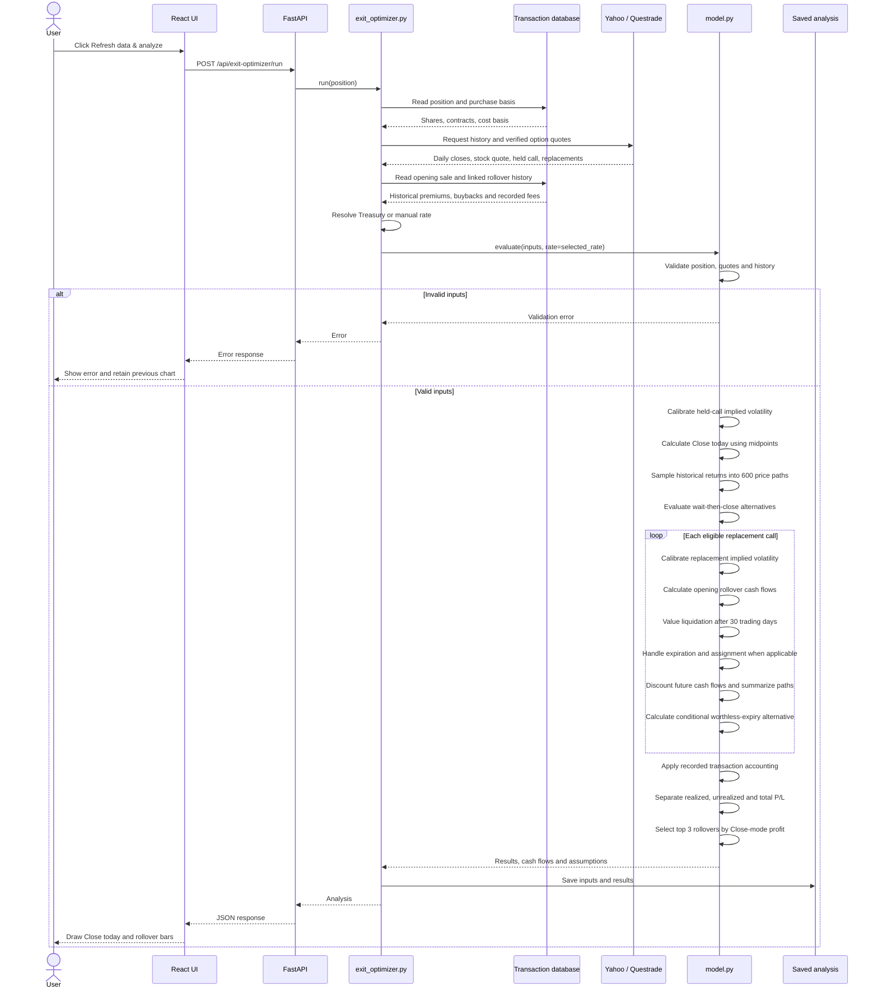
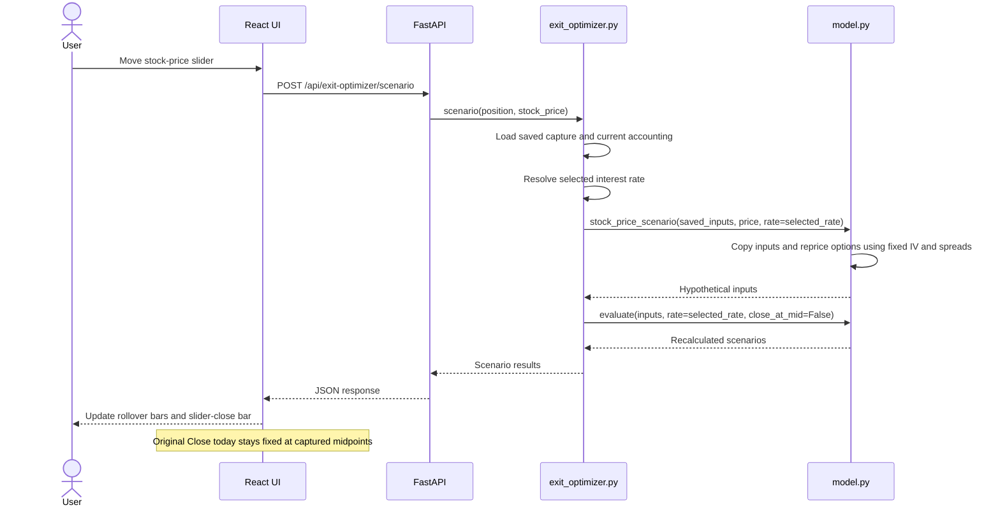

# coveredCallOptimizer

A local Python/React.js dashboard for covered-call holdings. It includes account
and stock filters, Questrade bid/ask quotes and Greeks, editable purchase prices,
minimum acceptable bids, stock-loss indicators and rollover payoff comparisons.
LIRA defaults to USD; RRSP/TFSA default to CAD. Yahoo provides a USD/CAD macro
reference with a past-month chart. The separate USD optimizer provides local stock-price scenarios, top-three rollover comparisons, Close/Expire outcomes and estimated rollover funding.

## AWS deployment

Single-EC2 deployment in us-west-2: [setup and manual user administration](deploy/README.md).
Email sign-in verifies active PostgreSQL users through single-use codes; there is no public registration.
See the [authentication architecture](docs/authentication.md).
Latest progress and next-session notes: [October 29 handoff](docs/progress-2026-10-29.md).
The separate `compose.aws.yaml` adds Caddy HTTPS and login; `compose.yaml`
continues to run the local application.

## Database

Docker Compose now uses PostgreSQL in a separate container with persistent storage.
See [migration, configuration and backups](POSTGRESQL.md). The original SQLite
file remains a legacy snapshot; host execution needs `DATABASE_URL` to use PostgreSQL.

## Run

Requires Python 3.12+ and the pinned FastAPI/Uvicorn dependencies in
`requirements.txt`. Node is used for calculation checks.

The active home page, optimizer, Profile / Settings and Recommendation panel use
React with pinned local dependencies. Rebuild UI changes with
`python frontend/build.py`; checked-in build artifacts work with the existing
FastAPI server immediately. See [frontend setup](frontend/README.md) and
[FastAPI / Docker setup](DOCKER.md).

```sh
python3 -m pip install -r requirements.txt
python3 dashboard_server.py
```

React calls FastAPI through `/api/` on the same origin. API documentation is at
http://localhost:8765/docs. To run in Docker, use `docker compose up --build -d`
after the local setup described in [DOCKER.md](DOCKER.md).

Open http://localhost:8765/covered-call-optimizer. My profile / Settings is
available there. Existing local records remain in `coveredCallOptimizer/data` and generated
captures in `coveredCallOptimizer/reports`; no data migration is required.

The old equity dashboard and its unused frontend components are preserved under
[archive/equity-dashboard](archive/equity-dashboard/README.md). Its former URL
redirects to the optimizer; optional archived view:
http://localhost:8765/archive/equity-chart.html. The archived generator writes to
the archive by default and is not part of normal startup or position refresh.
Synthetic examples remain in `examples/` for isolated checks, not live data replacement.

## Sources and refresh

Questrade supplies stock/option quotes, sizes, Greeks and listed contracts. Yahoo
supplies the dashboard reference feed and completed stock-price history for the USD optimizer; its reference is separate from actual brokerage FX
spread/charges. The local service refreshes FX every 60 seconds. Broker captures
refresh explicitly using these commands or the candidate refresh button:

```sh
python3 questrade_positions.py
python3 market_details.py
python3 roll_candidates.py --all
```

Configure Questrade authorization locally; see [setup](QUESTRADE.md). Position
sync currently supports a uniquely identified active LIRA. RRSP/TFSA snapshots
are entered locally; market quotes can still be sourced from Questrade.

Profile → Settings configures purchase prices and minimum stock bid per holding.
For CAD holdings, enter purchase-time CAD per USD FX in Settings. Original USD
purchase basis and the rollover strike floor use historical FX; current CAD
proceeds and break-even use the current conversion assumption. Missing historical
FX blocks rollover calculations instead of substituting today’s rate.
Settings are stored in your browser, separately by account and stock. The rollover
rule chooses purchase + USD 5 rounded up to the next listed strike, with editable
expiry range and minimum worthwhile net credit. Quote freshness and displayed
size are checked. Payoffs are conditional scenarios, not forecasts or guaranteed
fills. See [rollover details](ROLLOVER.md) and [physical architecture](ARCHITECTURE.md).

## Public checks

```sh
python3 -m pip install -r requirements-dev.txt
python3 -m unittest discover -s tests -p 'test_public_*.py'
python3 -m unittest discover -s tests -p test_fastapi.py
node tests/test_public_calculations.js
```

These checks use synthetic fixtures and do not require account credentials or
private portfolio files.

## FX sample entry

Expand **FX model · add transaction samples** in the dashboard. Paste a PNG/JPEG
confirmation (up to 8 MB), or select a file. Local Tesseract OCR proposes fields;
review and correct every field, select the account and confirm before saving.
Manual entry works if OCR is unavailable. USD converted means the confirmation
subtotal after commission, not gross security value. CAD totals must reconcile
with the applied CAD/USD rate. Exact duplicate entries are rejected.

Structured data is stored in PostgreSQL for the Compose deployment, outside the application image.
Images are used in a temporary OCR directory that is removed after extraction;
they are not stored in the database or sent to an external image service. Yahoo
receives only a historical date query. Missing Yahoo observations remain missing;
there is no fallback to a different date. JSON export and sample deletion are
available in the entry panel. The dataset does not modify portfolio holdings.
No prediction model or 1% accuracy claim is included at this stage.

Install Tesseract with English language data on a new machine. The current local
setup uses isolated Ubuntu packages under `.tools/ocr` without requiring sudo.
Restart `dashboard_server.py` after updating its source. Existing browser profile
and holding settings remain separate from the transaction dataset.

## Financial models

New model projects live under [`models/financials/`](models/financials/README.md).
The CIBC FX model workspace is [`cibc_fx/`](models/financials/cibc_fx/README.md).
Reviewed transaction data lives in PostgreSQL for the Compose deployment; model
training reads it without modifying saved samples. The original SQLite file is retained as a legacy snapshot.

## Opening option premiums

Expand **Option premiums · record opening sale** to record an opening call sale.
Enter account, ticker, expiry, strike, contracts, settlement date, USD premium per
share, total USD fees, applied FX and actual net CAD received. Review before saving.
The `option_premiums` database table persists confirmations
separately from FX model training samples. Exact duplicate confirmations are
rejected. A single exact match on account/ticker/expiry/strike/contract quantity
supplies the holding's net premium for dashboard calculations. Multiple matching
opening lots require explicit aggregation; the dashboard does not choose a lot.
This form supports standard calls with a 100-share multiplier. It does not execute
trades or refresh the FX model.

## Closing simulator and AI assessments

The application owns OpenAI integration; statistical models stay independent.
See [setup and usage](CLOSING_SIMULATOR.md). From the repository root, run
`python3 coveredCallOptimizer/setup_openai.py` for server-side key setup and
`python3 coveredCallOptimizer/close_simulator_server.py` to serve the simulator on port 8766.

## Shared stock cost basis

Stock purchase basis is stored in the database table `stock_cost_basis`,
keyed by account, ticker and account currency. Profile → Settings saves it through
`/api/stock-cost-basis`. Average cost is calculated from total cost and quantity.
The closing simulator and assessment service read this same table. Reload the
simulator or refresh its quotes after saving changes. Old browser-only basis
records are backed up locally and can be imported with the settings import button;
that explicit import replaces matching database bases. Profile names, bid thresholds
and option entry overrides remain browser preferences. The old seed JSON has been
archived; it is not a runtime source. Migration can be rerun without replacing
later database edits.

## Optimizer product direction

See [Reusable optimizer direction and priorities](docs/optimizer-product-direction.md) for the agreed direction toward broader trader needs, consistent outcome accounting, configurable objectives, risk scenarios and validation. Proposed work is distinguished from current features.

## Cash available and buying power

My profile → Settings includes **Cash available** and **Buying power**
fields, stored separately for RRSP, TFSA and LIRA in USD or CAD. Enter the amounts
reported by your broker for the selected account/currency, then Save profile.
Both amounts default to zero. Clearing a value and saving restores zero. A last-saved timestamp is retained for each pair.

These manual values are saved in this browser alongside other profile
preferences. Entered **USD buying power** is compared with each displayed
rollover's estimated net debit. Candidates exceeding it stay in the top three
and show the shortfall under a transparent diagonal-line rectangle. Adjacent
over-budget groups share a rectangle; bar colors, values and controls remain
visible and interactive. Equality passes; missing buying power defaults to zero. Saving Settings updates the display
without a market refresh or model recalculation. Cash available is not added to
buying power, and CAD values are not converted to USD for this check.

This compares estimated net rollover cash before future fees with the entered
amount; broker margin requirements can differ. It does not confirm broker
eligibility, change model calculations/rankings, or execute trades. No additional
database schema or broker call is involved.

## Interest-rate settings

**My profile → Settings → Interest rate** defaults to the U.S. Treasury yield
matched to the held call's remaining maturity. The app linearly interpolates
between published tenors, using the nearest tenor outside the published range.
A manual annual-yield override is available; the preference is saved in this
browser alongside the profile name. Saving recalculates saved-quote scenarios
without refreshing brokerage quotes or changing recorded transactions.

Source: [U.S. Treasury Daily Par Yield Curve](https://home.treasury.gov/resource-center/data-chart-center/interest-rates/TextView?type=daily_treasury_yield_curve),
retrieved server-side through the [official XML feed](https://home.treasury.gov/treasury-daily-interest-rate-xml-feed).
Settings shows the source observation date, matched expiry and bracketing tenors.
Matching uses the saved quote valuation date when reviewing a saved analysis;
the yield observation is the latest published date, not a historical-rate backtest.

The displayed annual yield is on a semiannual bond-equivalent basis. The app
passes `rate = 2 * log1p(annual_percent / 200)` explicitly to `model.evaluate()`
and to slider option repricing. The **same single rate** is used for held and
replacement calls, discounting and recommendation calculations. This is a
simplification: par yields proxy a zero rate, and replacement maturities and the
review horizon are not independently matched to the curve. The standalone
model retains its 4% default for reproducible offline examples; the application
supplies the selected rate explicitly.

Curves are cached for one hour. If refresh fails, a cached curve no more than
seven calendar days old can be used with a notice; otherwise automatic pricing
is unavailable until Treasury recovers or a manual rate is chosen. There is no
silent 4% fallback. The analysis snapshot and rollover CSV include the applied
rate, source and observation date. No API key or new database schema is needed.

## Rollover strike criteria

The optimizer places the owned-position price slider on the left and replacement-call
criteria on the right. On narrow screens, owned-position controls appear first.
The slider remains visible but disabled until a captured quote is available.

The replacement-call panel has two editable rules above the results:

1. **Minimum assignment price:** original stock purchase price × multiplier.
   The default is **1.2×**, meaning an assignment price at least 20% above purchase.
2. **Strike range relative to the stock midpoint:** minimum and optional maximum
   percentages. Defaults are **0% minimum and no maximum**, including both ATM
   and OTM calls. Negative percentages allow ITM calls below the midpoint,
   subject to the purchase-price floor; values must be at least -100%. A blank
   maximum means no cap. Both boundaries are inclusive.

Editing fields or clicking Reset criteria does not recalculate the chart.
Click **Refresh data & analyze** to retrieve quotes and apply the current fields.
A successful refresh stores the applied preference in this browser; a failed
refresh keeps the previous analysis and its applied rules. There is no separate
Reevaluate button. Slider scenarios, recommendations and CSV exports use the last
successfully applied rules, not unsubmitted edits.

For purchase price P, stock midpoint S, multiplier M, and lower/upper percentages:

```text
minimum strike = max(P × M, S × (1 + minimum_percent / 100))
maximum strike = S × (1 + maximum_percent / 100), or unlimited when blank
```

The application passes `purchase_price_multiplier`,
`min_strike_above_midpoint_pct` and `max_strike_above_midpoint_pct` explicitly
into `model.evaluate()`. Applied parameters and effective dollar boundaries are
retained in analysis snapshots and CSV. Existing contract/quote quality checks
and expiry rules still apply. A range conflicting with the assignment-price
floor produces no matching contracts rather than silently relaxing either rule.
Saved captures retain their quote coverage; scenarios requiring uncaptured
strikes request an explicit market refresh.

## From the UI to the covered-call model

The UI requests analysis, the application gathers market and transaction data,
and [`model.py`](models/financials/covered_call_exit/model.py) performs the
calculations. The model makes no network requests or database writes.
[`App.js`](frontend/src/App.js) handles UI requests,
[`dashboard_server.py`](dashboard_server.py) exposes the FastAPI endpoints, and
[`exit_optimizer.py`](exit_optimizer.py) connects the application to the model.

### Refresh data and analyze

The diagram shows the default 600 simulation paths and 30-trading-day horizon.
Close today uses captured stock and held-call midpoints; midpoint execution is
not guaranteed. Rollover cash flows retain bid/ask pricing assumptions.



Market-data failures can also stop the request before the model is called. An
unsuccessful refresh leaves the previous saved analysis intact. Displayed path
frequencies describe the simulation, not validated probabilities; early
assignment is not simulated.

### Change the stock-price scenario

The slider uses saved quotes and current recorded accounting without requesting
new market data. The original Close today bar stays fixed. The additional slider
close uses hypothetical stock-bid and call-ask estimates.



Changing the stock-price slider reprices saved option quotes and reruns the model
across its simulated paths and available captured contracts, then reranks the
results. It does not merely filter the previous three outcomes. The same sampled
return sequences are reused from the fixed seed, starting at the chosen price.
Busy (HTTP 409) scenario requests wait and retry with cancellation when the user
changes price or resets, rather than leaving the latest price uncalculated.

Resetting the slider to the captured stock midpoint restores the baseline in the
UI without another scenario request when its applied assumptions still match.
If assumptions have changed, the reset price is evaluated under those assumptions. Scenario calculations do not overwrite the
saved market capture.

### Model function guide

| Function | Responsibility |
| --- | --- |
| `evaluate()` | Validate inputs, simulate outcomes, calculate cash flows and rank candidates |
| `implied_volatility()` | Find the volatility consistent with a captured option midpoint |
| `call_price()` | Estimate option value from stock price, strike, remaining time, volatility and interest rate |
| `stock_price_scenario()` | Create hypothetical quotes without modifying captured inputs |
| `expire_worthless_outcome()` | Calculate the conditional option-only result with shares retained |
| `apply_accounting()` / `pnl_segments()` | Incorporate recorded history and separate P/L components |

The **Close / Expire** toggle selects between already-calculated results in the
UI; it does not rerun the model or change the Close-based candidate ranking.
Expire assumes the replacement call expires worthless and retains the shares,
so its option-only P/L is not directly comparable with full-position Close P/L.
The **AI recommendation** is separate: it interprets the calculated results and
selected objective rather than running inside `model.py`.
