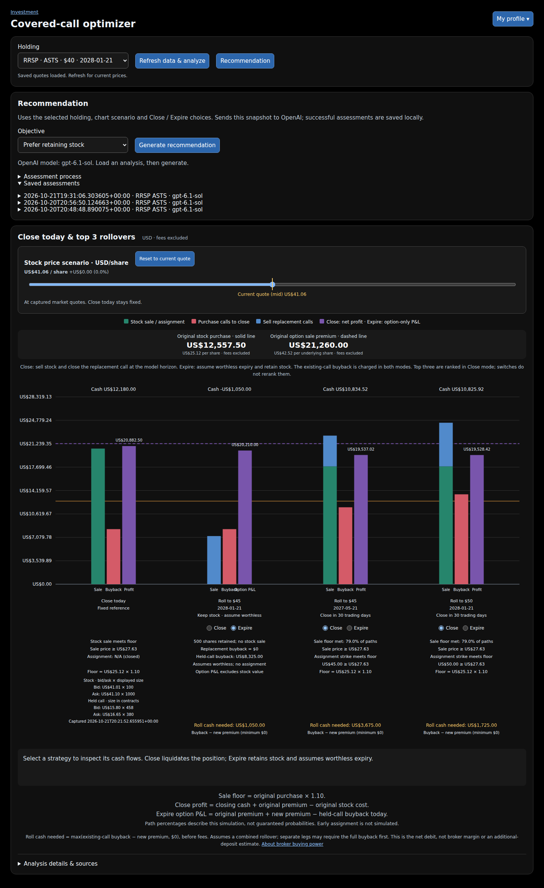

# Why I Built aiMoney to Make Covered-Call Decisions Clearer

An attractive option premium doesn't tell me whether rolling a covered call is a good decision.

I still need to know what it costs to close the existing call, what obligation the replacement creates, and how much cash I would release by simply closing the position. I also need to consider my objective: do I want to keep the shares or free up cash for something else?

That is why I built **aiMoney, a covered-call scenario analytics tool**.

It brings those questions into one visual workspace so I can examine the alternatives and the assumptions behind them.

## One position, several decisions

Take the ASTS position currently used in my saved example: **500 shares covered by five $40 calls expiring January 21, 2028**.

I can close the position, leave it in place, or explore buying back the existing calls and selling replacements at different strikes and expirations. The optimizer focuses on comparing a **Close today** reference with three ranked rollover alternatives.

The distinction that matters is that the new premium is only one part of the transaction. Before collecting it, I have to pay to buy back the existing call.

At the saved quotes, selling the ASTS shares would bring in **US$20,505**, while buying back the calls would cost **US$8,325**. Closing would therefore release **US$12,180 before fees**.

That figure is closing cash. It is not the profit earned over the life of the position.

## Making the trade-offs visible

aiMoney separates stock proceeds, option buyback costs, replacement premiums and the applicable profit measure. A stock-price slider lets me explore hypothetical rollover scenarios while the captured Close today reference stays fixed.

The screen also shows how much cash a rollover would require when the existing call's buyback costs more than the replacement premium brings in. That estimate is separate from the broker's margin or buying-power requirement.

**A limitation to keep in mind before reading the screenshot:** the profit bars include the recorded premium from the latest call sale but omit earlier rollover transactions. They do not represent verified lifetime profit. Fees are excluded, and the Expire view shows option-only P&L rather than full-position profit.

*Actual UI captured October 23, 2026, using saved October 21 quotes—not today's market prices. The first rollover is in Expire mode; the other two are in Close mode. Prior rollover history is missing from displayed profit.*

The two modes answer different questions. **Close** models liquidation at a 30-trading-day review horizon, with expiration and assignment handling when applicable. **Expire** explores the conditional case where the replacement call expires worthless and I retain the shares. It does not predict that worthless expiration will happen.

## Adding a recommendation tied to my objective

Numbers alone don't resolve the decision. Wanting to retain ASTS shares is different from wanting cash for another investment.

The **Recommendation** feature lets me select **Prefer retaining stock**, **Free cash for another investment**, or **Compare alternatives**. It then sends the selected position, chart scenario, Close / Expire choices and calculated cash flows to OpenAI for a conditional assessment.

The application calculates the scenarios and ranks the rollover candidates. The AI helps interpret the results against my objective; choosing an objective does not re-rank the chart. Assessments and their input snapshots are saved so I can review the reasoning later.

It does not place trades, receive my available account cash balance or independently assess live market news. It also inherits the chart's accounting limitations.

## The accounting lesson behind the chart

While reviewing the app, I came back to a basic question: **why doesn't the displayed profit reconcile with my account balance?**

One gap is the missing rollover history. A complete view needs all linked premiums, buyback costs and fees counted once across the position's life. Even a rollover that produces positive cash does not, by itself, establish an overall profit.

That discovery has helped clarify what the app needs to distinguish: cash received, cash required, scenario profit and cumulative performance. Those are different measures, and a useful chart needs to make their meaning clear.

The current model also holds volatility and spreads fixed, excludes fees and taxes, and does not simulate early assignment. Its option-pricing accuracy has not been established through historical backtesting. I use it to examine conditional trade-offs, with those assumptions in view.

## Trying aiMoney

aiMoney is available at **[aimoney.kodekomplete.com](https://aimoney.kodekomplete.com)**. Access is by invitation: contact me to arrange authorization for your email address. There is no public registration form.

Authorized users sign in with an eight-digit email code, which expires after ten minutes. The current version uses a shared portfolio workspace; separate private portfolios and role-based permissions are future work.

For me, building aiMoney has been as much about asking better questions as producing calculations. With ASTS, the useful question is how each alternative changes cash requirements, share ownership and future obligations—and which assumptions could change the answer.

**When you review a covered-call rollover, which number do you look at first: the new premium, the net cash flow, or the full position's gain or loss?**
