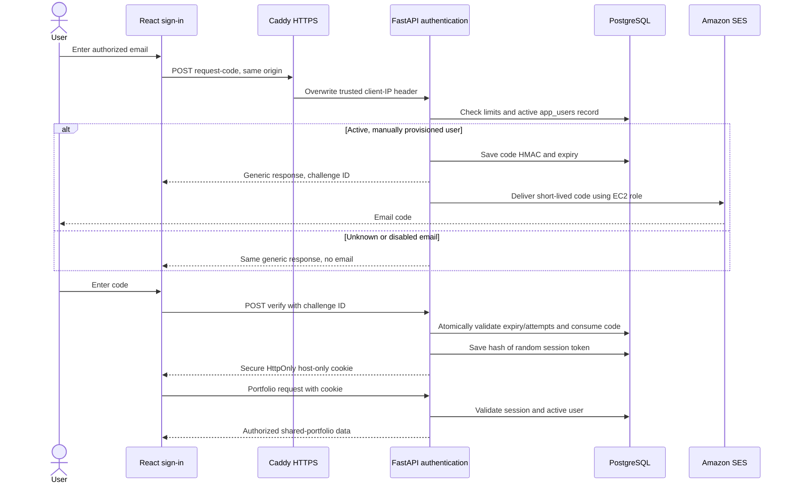
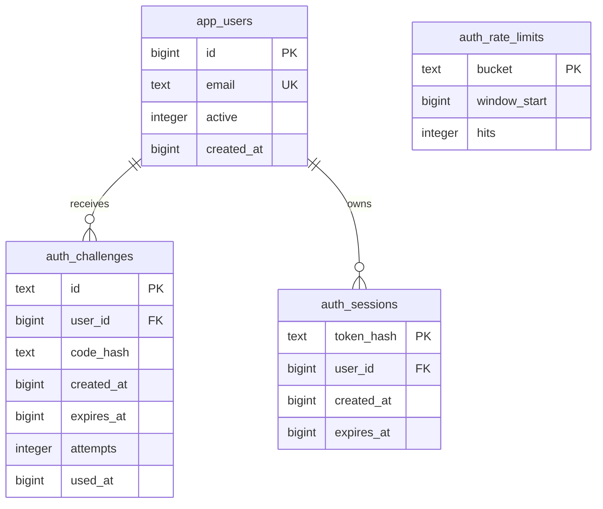

# Authentication architecture

Authorized accounts are created manually in PostgreSQL. There is no public signup.
The operator manages users through `auth_admin.py` or SQL; see the
[administration guide](../deploy/README.md). Everyone authorized currently shares
one portfolio, including its settings and application controls.

Codes expire after 10 minutes and 5 attempts. Every accepted request replaces
that user's previous code. Rate limits cover email, client IP and global sending;
verification attempts are limited per challenge and IP. PostgreSQL transaction
locks prevent concurrent code reuse. Database failures fail closed.

The browser session lasts 12 hours, or 30 days with the personal-device option.
Sign-out revokes it server-side. Each protected request checks the user's active
status, so disabling a user blocks existing sessions immediately. The minimal
health endpoint and sign-in assets contain no portfolio records and remain public.

The HMAC secret, broker credentials and provider configuration stay in `.secrets/`
on encrypted EBS, outside Git and image layers. AWS credentials are temporary
instance-role credentials with permission only for the app's SES sender.

Future work: scheduled backups and recovery drills, audit events and explicit
roles. Per-user portfolios require ownership and access checks throughout the
data model and API, plus separated broker credentials; adding email accounts
alone does not create that isolation. See [future direction](../ARCHITECTURE.md#future-direction).
