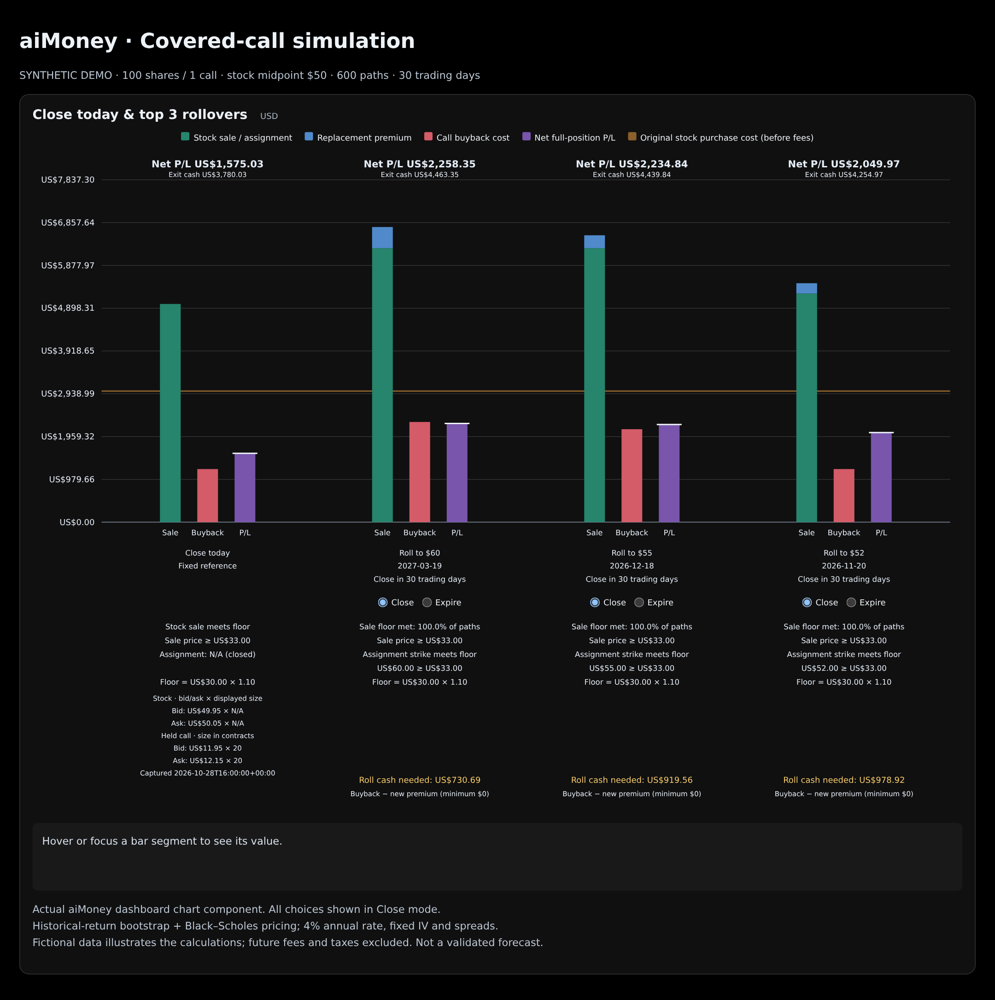

# Covered-call exit scenario model

Compare **closing a covered-call position now** with **waiting to close** or
**rolling the call now and closing the resulting position later**. The model
estimates USD cash flows and whole-position profit, and ranks replacement calls
under explicit strike, expiry and quote-quality criteria.

The core combines two methods:

1. **Historical return bootstrap:** generates possible future stock-price paths.
2. **Black–Scholes European call formula:** estimates the option liability at a
   future exit, using a constant implied volatility calibrated for each contract.

This is an experimental mathematical scenario engine, implemented in Python's
standard library. It has no neural-network weights, training pipeline, broker
connection or order execution. Downloading the repository does not create a hosted
inference API. The included data is entirely synthetic.

## Simulation at a glance — aiMoney dashboard chart



This image is rendered by **aiMoney's actual React dashboard chart component**,
using the included synthetic model inputs. It is the same chart used in the app,
with all three rollover controls shown in **Close** mode. The screenshot is static;
its Close/Expire controls and hover details are interactive only in aiMoney.

The example holds **100 shares covering one $40-strike call**, with a captured
stock midpoint of **$50**, a stock purchase cost of **$3,005 including fees**, and
**$800 recorded net option cash including prior linked cycles**. Everything is fictional.

Each strategy has three adjacent columns:

| Chart element | Meaning |
|---|---|
| Green Sale, with any blue segment above | Stock sale/assignment proceeds, plus replacement premium where applicable |
| Red Buyback | Call-buyback cost, drawn upward as a cost magnitude; subtract it from sale cash |
| Purple P/L | Estimated whole-position profit, including recorded option cash and original stock cost/fees |
| Brown horizontal line | Original stock purchase cost before purchase fees |
| Net P/L label | The strategy's total profit, matching the purple bar |
| Exit cash label | Sale cash less buyback costs; it excludes historical cash/basis adjustments |
| Sale-floor and funding labels | Simulated floor-pass fractions and estimated net cash needed to roll |

**Close today** is the fixed captured-bid/ask reference: **$1,575.03 total profit**.
The other groups are the model's three highest-ranked replacement calls. Their
cash-flow bars and P/L summarize the **same 600 simulated stock paths**, with a
**30-trading-day review horizon**. Earlier expirations settle within each path.
The costs and proceeds shown for future exits are discounted mean amounts.

**How the model produces this chart:** three months of artificial historical
returns → 600 bootstrapped stock paths → Black–Scholes values for unexpired
replacement calls → stock/option exit cash flows and expiry settlement → 4%
discounting → recorded cash/basis adjustments → rank by estimated profit.

The purple bar is the whole-position result; a tall red buyback bar by itself is
not an overall position loss. The figure shows Close-mode comparisons only.
Switching to Expire in aiMoney shows conditional option-only cash while retaining
shares, which is a different valuation basis. This chart does not draw percentile
whiskers; simulation ranges are available in the reference JSON.

The original dashboard component and styles render this image directly; the
plot values are not redrawn by a separate plotting library. Every purple bar is
checked against `examples/expected_result.json`. Provenance records the frontend
source checksums. To regenerate from an aiMoney frontend checkout, install the
optional `playwright` dependency and Chromium, then run:

```sh
python3 examples/render_aimoney_chart.py --frontend-dir /path/to/aiMoney/frontend
```

The model itself remains standard-library only. These sample results illustrate
its arithmetic and assumptions; they do not establish that a rollover will
outperform closing in actual markets.

## Run the example

Requires Python 3.10+; no pip installation or credentials are needed. From the
downloaded repository:

```sh
python3 run_example.py
python3 -m unittest discover -s tests
```

The example writes `example_result.json` and `example_rollovers.csv` (Excel-compatible,
UTF-8 with BOM). CSV contains every matching rollover, ranked by total position
profit descending. These outputs demonstrate code behavior, not investment performance.

Python usage:

```python
import json
from model import evaluate, call_price

with open('examples/sample_input.json') as stream:
    inputs = json.load(stream)

result = evaluate(inputs, horizon=30, paths=600, seed=42, rate=0.04)
for choice in result['top_choices']:
    print(choice['expiry'], choice['strike'], choice['total_pl_usd'])

# Fictional standalone pricing example: 23 days to expiry, 80% annual IV.
print(call_price(spot=50, strike=52, years=23/365,
                 volatility=0.80, rate=0.04))
```

To evaluate supplied data or change the assumed interest rate:

```sh
python3 run_example.py --input my_inputs.json --rate 0.041
```

`rate` is a continuously compounded annual USD rate expressed as a decimal.
The default 4% is a fixed assumption, not an automatically retrieved market yield.

## Mathematics

### 1. Stock-price paths: historical bootstrap

From completed daily stock closes in the preceding three calendar months:

$$r_t=\ln(P_t/P_{t-1})$$

Each simulated day independently samples one historical log return **with
replacement**, then updates price:

$$S_{j+1}=S_j\exp(r_j^*)$$

Every path starts at the captured stock bid/ask midpoint (or the selected
hypothetical stock midpoint). Default settings are **600 paths**, **30 trading
days**, and random seed **42**. All strategies face the same paths. At least 40
unique completed closes are required. The model retains the historical sample's
drift rather than imposing risk-neutral drift on stock paths.

The option IV is not the stock-path volatility input: the paths use historical
returns directly. They are generated independently of the Black–Scholes formula.

### 2. Option prices: Black–Scholes, without dividends

For remaining time $T>0$:

$$C=S\Phi(d_1)-Ke^{-rT}\Phi(d_2)$$

$$d_1=\frac{\ln(S/K)+(r+\sigma^2/2)T}{\sigma\sqrt{T}},
\qquad d_2=d_1-\sigma\sqrt{T}$$

| Symbol | Meaning |
|---|---|
| $C$ | European call value in USD per share |
| $S$ | Stock price in USD per share |
| $K$ | Strike in USD per share |
| $T$ | Remaining calendar time in years, using 365 days |
| $r$ | Continuously compounded annual risk-free-rate assumption |
| $\sigma$ | Annual implied volatility as a decimal, e.g. 0.80 = 80% |
| $\Phi$ | Standard normal cumulative distribution function |

At expiry the call's intrinsic value is $\max(S-K,0)$.

Reference: [Durham University mathematical finance notes, section 5.4](https://www.maths.dur.ac.uk/users/nicholas.georgiou/Teaching/2021-22/MF/the-blackscholes-formula.html#the-formula).
The implementation uses `math.erf` to evaluate the normal CDF.

### 3. Calibrate implied volatility to the captured midpoint

For each usable option, solve:

$$C(S,K,T,\sigma,r)=(\mathrm{bid}+\mathrm{ask})/2$$

`implied_volatility()` uses 70 binary-search iterations over annual volatility
0.0001 to 8.0. The contract is excluded if its midpoint fails the implemented
Black–Scholes price-bound check. The search has no explicit final convergence
check for prices requiring IV beyond its bounded search interval.

This version calibrates IV itself; it does not directly use a broker's reported
IV field. Matching the original midpoint is calibration, not independent proof
of pricing accuracy. Captured IV stays constant for subsequent scenario pricing.

### 4. Estimated liquidation and expiration

At a future exit before expiry, estimate the buyback ask as:

$$\mathrm{ask}_{future}=C(S_{future},K,T_{remaining},\sigma,r)
  +(\mathrm{ask}_{captured}-\mathrm{bid}_{captured})/2$$

Use stock bid for stock sales, the held call's captured ask to close it now,
and the replacement's captured bid to sell it now. Future stock bids use the
captured stock half-spread, floored at zero.

When replacement expiry occurs on/before the exit horizon, the model settles it
at an approximate expiry step: $\max(1,\lceil\mathrm{calendarDays}\times252/365\rceil)$.
At/above strike the short call is assigned and covered shares deliver at strike;
otherwise the call expires and retained shares sell at the review horizon.
Assignment cash earns the assumed rate until review. Calendar-to-trading-day
conversion is approximate; there is no holiday calendar or intraday expiry model.
Early assignment is not modeled.

### 5. Cash flows, discounting and whole-position profit

For a rollover the model counts the held-call buyback and replacement premium
**once**, then includes the stock and replacement liability at the selected exit.
Future cash is discounted with $\exp(-r\,d/252)$ for $d$ trading days. Immediate
rollover cash is not discounted as though it occurred at the future horizon.

$$\mathrm{totalPL}=\mathrm{discountedLiquidationCash}
 +\mathrm{currentCycleHistoricalOptionNetCash}
 -\mathrm{stockPurchaseCostIncludingRecordedFees}
 +\mathrm{linkedPriorCycleOptionPL}$$

The caller supplies recorded history; the engine does not reconstruct a trade
ledger. Fees included in supplied history/cost must already be allocated once.
Future execution fees and taxes are excluded.

`net_profit_usd` is current-cycle whole-position P/L; `total_pl_usd` also adds
linked prior-cycle option P/L. Missing required accounting inputs leave profit
unavailable, not zero. Partial known earlier receipts may remain visible.

Rows report simulated mean, 10th/90th percentiles, sale-floor pass fraction and
fraction beating immediate close. `mean`, `p10`, and `p90` are discounted
liquidation wealth, not historical-cost-adjusted P/L. Add the same recorded
cash/basis adjustment to translate them into whole-position P/L.

## Candidate criteria and ranking (version 1.13)

- Standard 100-share calls, with shares exactly covering the contract count.
- Replacement strike **at least 1.20 times original USD purchase price** and
  **strictly above the current/scenario stock midpoint**. No fixed upper strike cap.
- Expiry after valuation date, through one calendar year after held-call expiry.
  Same-day expiry and the exact held contract are excluded.
- Validated contract; finite positive noncrossed bid/ask; reported delay zero;
  not halted; both option bid/ask sizes at least the number of contracts.
- Implied-volatility calibration must pass the price-bound check described above.
- A sale floor of **1.10 times purchase price** is reported with pass fractions.
  Floor failures and negative estimated profits remain eligible for display.

`rows` includes every matching rollover plus close/wait benchmarks. The engine
sorts diagnostic `rows` by floor eligibility and mean wealth; `top_choices`
selects the three highest `net_profit_usd` rollovers regardless of floor failure
or profit sign. For one position with complete history, adding common prior-cycle
cash does not change profit ordering. `run_example.py` explicitly sorts the full
rollover CSV by `total_pl_usd`, with unavailable totals last.

The optional stock-price scenario helper reprices captured calls at a selected
spot within ±50% of captured midpoint, retaining calibrated IV and absolute
spreads, then re-evaluates. Applications should preserve the original captured
close-today benchmark when displaying such hypothetical scenarios.

## Conditional worthless-expiry outcome

Each rollover also has `expire_worthless`: assume its replacement expires
worthless, without assignment, with all shares retained. The existing held-call
buyback is still paid now; the replacement needs no later buyback.

**This outcome is option cash/P/L only. It excludes retained stock value and is
not comparable whole-position profit.** Even its `total_pl_usd` field is an
option-only total including linked prior cycles. `net_profit_usd` is null in this
outcome. This version requires an explicit future-stock valuation assumption to
construct a comparable whole-position expiry result; none is silently added.

## Synthetic sample data

`examples/sample_input.json` is fully fictional and regenerated with
`python3 examples/make_sample.py`. It contains:

| Field | Synthetic example |
|---|---|
| Symbol/account | DEMO / SYNTHETIC |
| Valuation date | October 28, 2026 (fixed; not the current date) |
| Position | 100 shares covering 1 call |
| Original stock purchase | $30/share plus $5 recorded purchase fees |
| Captured stock bid/ask | $49.95 / $50.05 |
| Held call | $40 strike, January 15, 2027 expiry |
| Synthetic call quotes | Generated from Black–Scholes at 65% IV, midpoint ±$0.10 |
| Current-cycle historical option net cash | $700 |
| Linked prior-cycle option P/L | $100 |
| Current-cycle completed-call P/L | $200 (component; do not add again) |
| Replacement candidates | Three matching contracts, one below-spot rejection, one delayed-quote rejection |

History is an artificial sequence generated with seed 17 and a fixed menu of
returns. Weekday labels omit weekends but do not model exchange holidays. Quote
sizes and validation flags are synthetic examples, not live verification.

On the provided fixture, the default run produces approximately:

| Strategy | Estimated whole-position P/L, USD |
|---|---:|
| Close now | 1,575.03 |
| Roll to March 19, 2027, strike $60 | 2,258.35 |
| Roll to December 18, 2026, strike $55 | 2,234.84 |
| Roll to November 20, 2026, strike $52 | 2,049.97 |

These values only verify a reproducible example. The sample does not establish
forecast accuracy, an expected investment return or a winning strategy.

## Validation and limitations

The repository includes 16 synthetic unit tests covering reproducibility,
constraints, accounting, expiry outcomes, funding and scenarios. These are
software correctness checks. There is **no historical option-chain backtest,
out-of-sample forecast evaluation, or validated prediction-accuracy metric**.

The model assumes independent historical-return samples, constant calibrated IV,
constant captured spreads and a fixed review horizon. Short history restricts
tail scenarios and ignores volatility clustering. European pricing approximates
American equity calls; dividends, early assignment, corporate actions, taxes,
future fees, cash/margin limits, changing liquidity and alternative reinvestment
opportunities are omitted. Quote validation uses supplied flags/sizes and does
not independently verify quote timestamps or guarantee fills. Zero reported
delay alone cannot prove that a saved quote is recent.

Use it to explore explicit assumptions and audit arithmetic. It is not an
execution system or a validated investment recommendation engine.

## Files and provenance

- `model.py`: unchanged standalone aiMoney model, version 1.13.
- `run_example.py`: JSON evaluation and full ranked rollover CSV export.
- `examples/sample_input.json`: synthetic fixture.
- `examples/make_sample.py`: deterministic fixture generator.
- `examples/expected_result.json`: complete reference output for the fixture.
- `examples/expected_rollovers.csv`: matching ranked reference export.
- `tests/test_model.py`: synthetic unit tests.
- `examples/simulation-profit.png`: annotated bar chart of the synthetic simulation.
- `examples/render_aimoney_chart.py`: optional capture script using the original aiMoney frontend and Playwright.
- `examples/simulation-chart-provenance.json`: chart and input/output checksums.
- `manifest.json`: SHA-256 checksums of the package payload.

The package contains no real portfolio records, brokerage credentials, private
captures, transaction confirmations, screenshots or account identifiers. It makes
no network requests during evaluation. A caller must supply and validate its own
market data and respect the data provider's redistribution terms.
